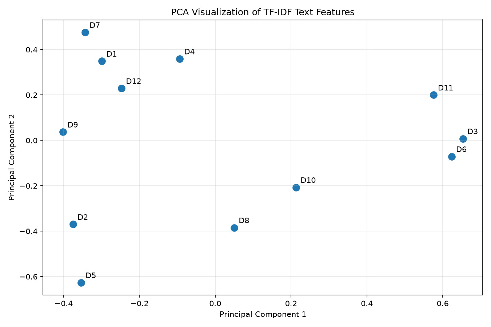

# Experiment 10 - PCA on TF-IDF Text Vectors

## Aim
Convert a small corpus of 12 text documents into TF-IDF vectors, reduce them to 2 dimensions with
Principal Component Analysis (PCA), and visualise the documents in the reduced space.

## Files
- `experiment10.py` - the program
- `output.txt` - captured console output of a real run
- `pca_visualization.png` - scatter plot produced by the script

## How to run
```
pip install scikit-learn matplotlib pandas numpy
python experiment10.py
```
The plot is saved next to the script as `pca_visualization.png` (Agg backend, no window opens).

## Steps
1. Define 12 sample documents.
2. `TfidfVectorizer(stop_words="english")` builds the TF-IDF matrix.
3. Convert the sparse matrix to a dense array with `toarray()`.
4. `PCA(n_components=2)` reduces the 44 features to 2 principal components.
5. Print the transformed features as a DataFrame.
6. Plot the documents (D1..D12) on the two components.

## Results (from a real run)

| Stage | Value |
|---|---|
| Documents | 12 |
| TF-IDF features (after stop-word removal) | 44 |
| TF-IDF shape | (12, 44) |
| Shape after PCA | (12, 2) |
| Explained variance ratio | [0.1937, 0.1321] |
| Total variance preserved | 0.3258 (about 32.6%) |

### PCA transformed features

| Document | Principal_Component_1 | Principal_Component_2 |
|---|---|---|
| Document_1 | -0.2990 | 0.3489 |
| Document_2 | -0.3753 | -0.3696 |
| Document_3 | 0.6531 | 0.0076 |
| Document_4 | -0.0938 | 0.3592 |
| Document_5 | -0.3541 | -0.6262 |
| Document_6 | 0.6234 | -0.0708 |
| Document_7 | -0.3435 | 0.4760 |
| Document_8 | 0.0500 | -0.3844 |
| Document_9 | -0.4018 | 0.0370 |
| Document_10 | 0.2130 | -0.2068 |
| Document_11 | 0.5755 | 0.2000 |
| Document_12 | -0.2474 | 0.2292 |

### Extra (not in the PDF): cumulative explained variance
PC1: 0.1937, PC2: 0.3258, PC3: 0.4399, PC4: 0.5503, PC5: 0.6430, PC6: 0.7223, PC7: 0.7980,
PC8: 0.8682, PC9: 0.9190, PC10: 0.9658, PC11: 1.0000. About 11 components are needed to retain all the
variance.

### Visualisation


## Notes
- **What PCA does:** it finds new orthogonal axes (principal components) along which the data varies
  most, ordered by explained variance, and projects the data onto the first few. This reduces
  dimensionality while keeping as much variance as possible.
- **Why only about 32.6% is preserved:** the TF-IDF matrix is tiny (12 documents) but wide (44 features)
  and very sparse. Each document uses only about 4-6 of the 44 terms, and many terms appear in just one
  document, so the variance is spread across many nearly independent directions instead of a few
  dominant ones. With 12 samples, the centred data has at most 11 non-zero components, and each one
  carries a modest share. Two components therefore capture only about a third of the variance.
- **Reading the plot:** documents about natural language processing / sentiment (D3, D6, D11) sit
  together on the right (high PC1), while the machine learning / deep learning documents (D1, D7, D9,
  D12, D2, D5) sit on the left. Documents that share few terms with the others (D8, D10) fall in the
  middle. Since 2D keeps only about a third of the variance, distances in the plot are only a rough
  guide to similarity.
- PCA is applied to a dense array because `sklearn.decomposition.PCA` needs to centre the data, which
  would destroy sparsity anyway (TruncatedSVD is the sparse-friendly alternative).
